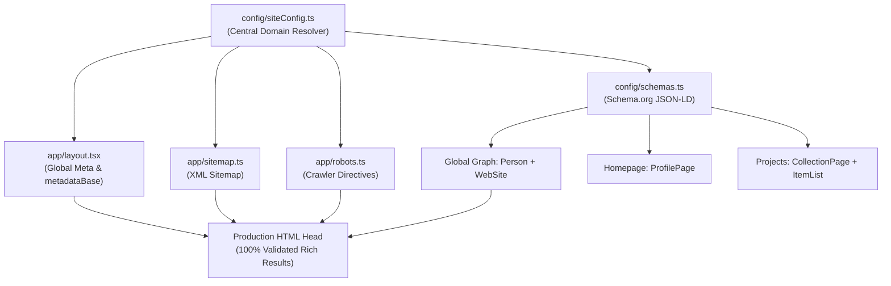

<div align="center">

# Manoj Pawar — Software Engineering Portfolio

**High-performance, physics-animated personal developer portfolio and project showcase.**

[](https://nextjs.org/)
[](https://react.dev/)
[](https://www.typescriptlang.org/)
[](https://tailwindcss.com/)
[](https://manojpawar.vercel.app)
[](LICENSE)

[🌐 Live Production Website](https://manojpawar.vercel.app) • [💼 LinkedIn Profile](https://linkedin.com/in/pawar-manoj/) • [🐙 GitHub Profile](https://github.com/manoj-9899) • [✉️ Email Contact](mailto:manojpawar.dev@gmail.com)

</div>

---

## 📌 Overview

This repository houses the source code for the personal software engineering portfolio of **Manoj Shivaji Pawar**, Computer Engineering undergraduate at **Dr. Babasaheb Ambedkar Technological University (DBATU), Lonere**.

Engineered for extreme performance, clean typography, and search engine discoverability, this portfolio showcases production applications in full-stack web development, post-quantum cryptography, developer tooling, and distributed systems.

### Key Architectural Highlights

- **⚡ Zero-Re-Render Physics Engine:** Interactive project cards use Motion spring physics (`useCompositorSpring` and `useOffset`) binding directly to composite transforms without triggering React component re-renders during high-frequency scroll events.
- **🔍 Production-Grade Technical SEO:** Implements Schema.org JSON-LD graph structures (`Person`, `WebSite`, `ProfilePage`, `CollectionPage`, `ItemList`), dynamic XML sitemaps, robots crawler directives, and multi-platform Open Graph 1200×630 cards.
- **🚀 Ultra-Slim Asset Footprint:** Completely pruned of legacy template bloat; public static payload is under 55 KB total with vector SVG sprites and Next.js Image WebP optimization.
- **🎨 Modern Aesthetic & Access:** Fluid typography powered by Switzer Variable font, subtle noise layering, accessible contrast ratios, and cross-browser responsive layouts.

---

## 🗂️ Table of Contents

- [Overview](#-overview)
- [Featured Projects](#-featured-projects)
- [Technical Stack](#-technical-stack)
- [Repository Structure](#-repository-structure)
- [Getting Started](#-getting-started)
  - [Prerequisites](#prerequisites)
  - [Environment Setup](#environment-setup)
  - [Installation & Local Run](#installation--local-run)
  - [Available Scripts](#available-scripts)
- [SEO & Structured Data Architecture](#-seo--structured-data-architecture)
- [Performance & Optimization](#-performance--optimization)
- [Deployment](#-deployment)
- [Author & Contact](#-author--contact)
- [License](#-license)

---

## 🚀 Featured Projects

| Project | Domain / Type | Key Technologies | Repository |
| :--- | :--- | :--- | :--- |
| **Post-Quantum Document Enclave** | Applied Cryptography & Security | Post-Quantum Cryptography, Web Crypto API, Digital Signing, Forensic Watermarking | [github.com/manoj-9899/sih](https://github.com/manoj-9899/sih) |
| **DevHabits** | Local-First Developer Tooling | React, Node.js, CLI / TUI, SQLite, Streak Heatmaps, Data Persistence | [github.com/manoj-9899/devhabits](https://github.com/manoj-9899/devhabits) |
| **CampusCanteen** | Full-Stack Campus Platform | React, Node.js, Express, MongoDB, Role-Based Auth, QR Pickup Engine | [github.com/manoj-9899/CampusCanteen](https://github.com/manoj-9899/CampusCanteen) |
| **FocusTube** | AI Browser Assistant | Chrome Extension (Manifest V3), Groq LLM Inference, Express, Focus Analytics | [github.com/manoj-9899/focustube](https://github.com/manoj-9899/focustube) |

### 1. Post-Quantum Document Enclave & Forensic Attribution System
A secure, browser-native document lifecycle platform leveraging post-quantum algorithms, hybrid symmetric-asymmetric encryption, robust digital signatures, imperceptible forensic watermarking, and tamper-evident audit trails designed to withstand quantum cryptanalysis.

### 2. DevHabits
A developer-first habit engineering utility designed for local-first operations. Features both a responsive React analytics dashboard and a terminal-native Node.js CLI/TUI backed by SQLite, offering streak tracking, commit heatmaps, and privacy-preserving offline storage.

### 3. CampusCanteen
An enterprise-grade campus ordering and queue orchestration system featuring JWT role-based access control (Students, Kitchen Staff, Administrators), real-time inventory updates, and cryptographic QR verification for line-free meal pickups.

### 4. FocusTube
A productivity assistant Chrome Extension built on Manifest V3. Intercepts video streams, analyzes transcripts in real-time via low-latency Groq LLM inference, generates executive takeaways, and computes focus retention metrics backed by a lightweight Express API.

---

## 💻 Technical Stack

### Core Languages & Systems
- **Languages:** C++, Python, JavaScript (ESNext), TypeScript (Strict), SQL
- **Architecture:** Client-Server, RESTful APIs, Local-First Architecture, Applied Cryptography

### Frontend Engineering
- **Framework:** Next.js (App Router, Turbopack)
- **Library:** React 19 (Server & Client Components)
- **Styling:** Tailwind CSS v4, CSS Variables, PostCSS
- **Animation & Motion:** Motion (Framer Motion v12), Composite Spring Physics, CSS View Transitions

### Backend & Databases
- **Runtime:** Node.js, Express.js
- **Databases:** PostgreSQL, MongoDB, SQLite, Supabase
- **ORMs & Tooling:** Prisma, SQL Query Builders, SQLite3

### DevOps, Tooling & Quality Assurance
- **Version Control:** Git, GitHub Actions
- **Testing:** Playwright End-to-End Testing
- **Linters & Formatters:** ESLint 9, Prettier
- **Icon Pipeline:** Zero-UI Custom Icon Sprite Builder
- **Platform:** Vercel Edge Network

---

## 📂 Repository Structure

```text
portfolio/
├── app/
│   ├── (site)/
│   │   ├── page.tsx               # Homepage (Hero, Interactive Physics Grid, About, Services, Contact)
│   │   ├── projects/
│   │   │   └── page.tsx           # Projects archive index route with metadata & schemas
│   │   └── serbyte-dev-credit/
│   │       └── page.tsx           # Technical architecture attribution & source credits
│   ├── components/
│   │   ├── AboutSectionV2.tsx     # Technical bio, education, and development philosophy
│   │   ├── HeroV2.tsx             # Interactive header showcase with dynamic status pills
│   │   ├── Icon.tsx               # High-performance SVG sprite consumer component
│   │   ├── ProjectCard/           # Physics-driven composite cards with spring interpolation
│   │   ├── ProjectsGrid.tsx       # 4-card animated interactive showcase
│   │   ├── RecruiterContact.tsx   # Direct hiring channels, email, and social connections
│   │   ├── ServicesSectionV2.tsx  # Core competencies, technologies, and skills grid
│   │   ├── TopBar/                # Floating blurred navigation pill with custom branding
│   │   └── ui/                    # Reusable atomics (CallToActionButton, AnimatedH2, etc.)
│   ├── fonts/                     # Self-hosted Switzer Variable woff2 font
│   ├── images/                    # Verified authentic project previews and profile images
│   ├── favicon.ico                # Primary 256×256 application favicon
│   ├── layout.tsx                 # Root layout, metadataBase, Switzer font, global JSON-LD
│   ├── opengraph-image.jpg        # Standard 1200×630 social preview card
│   ├── robots.ts                  # Programmatic robots.txt generator
│   └── sitemap.ts                 # Programmatic sitemap.xml generator
├── config/
│   ├── schemas.ts                 # Schema.org JSON-LD builders (Person, WebSite, ItemList)
│   └── siteConfig.ts              # Canonical site configuration and environment URL resolvers
├── public/
│   ├── assets/
│   │   └── framer-noise.png       # Subtle background texture
│   ├── custom-icons.svg           # Vector symbol sprite for brand & tech icons
│   ├── google*.html               # Google Search Console HTML verification file
│   └── icons.svg                  # Compiled UI sprite
├── next.config.ts                 # Next.js build and Turbopack compiler configuration
├── package.json                   # Dependency tree and script declarations
├── tailwind.config.ts             # Tailwind CSS tokens and themes
└── tsconfig.json                  # TypeScript compiler options (Strict mode enabled)
```

---

## 🛠️ Getting Started

### Prerequisites

- **Node.js:** `v20.x` or higher recommended (`v18.18+` minimum)
- **Package Manager:** `npm` (included with Node.js) or `pnpm`

### Environment Setup

The application automatically resolves canonical URLs, sitemaps, and social share metadata based on the `NEXT_PUBLIC_SITE_URL` environment variable.

1. Create a `.env.local` file in the root directory (optional for local development):
   ```bash
   NEXT_PUBLIC_SITE_URL=https://manojpawar.vercel.app
   ```
2. If left unset during local development, the application defaults gracefully to `https://manojpawar.vercel.app` without generating broken links or leaking localhost domains into production schemas.

### Installation & Local Run

```bash
# 1. Clone the repository
git clone https://github.com/manoj-9899/portfolio.git
cd portfolio

# 2. Install dependencies
npm install

# 3. Start local development server with Turbopack
npm run dev
```

Open [http://localhost:3000](http://localhost:3000) in your browser to view the application.

### Available Scripts

| Command | Action |
| :--- | :--- |
| `npm run dev` | Starts the Next.js development server with hot-module reloading |
| `npm run build` | Compiles optimized static production bundles via Next.js Turbopack |
| `npm run start` | Boots the Next.js standalone production server locally |
| `npm run type-check` | Runs the TypeScript compiler (`tsc --noEmit`) to validate type safety |
| `npm run lint` | Analyzes code for stylistic and syntax errors via ESLint |
| `npm run format` | Enforces formatting across all files using Prettier |
| `npm run test` | Executes the Playwright end-to-end integration test suite |

---

## 🔎 SEO & Structured Data Architecture

Search engine discoverability and social platform presentation are engineered according to official **Google Search Essentials** and **W3C** standards:



1. **Schema.org Linked Graph:**
   - **`Person`:** Declares Manoj Shivaji Pawar, educational affiliation (DBATU Lonere), authenticated GitHub & LinkedIn profiles, and verified technical proficiencies.
   - **`WebSite`:** Identifies the official developer portfolio with author attribution.
   - **`ProfilePage`:** Formal declaration of the homepage as the primary entity profile.
   - **`CollectionPage` & `ItemList`:** Structured project entities indexing all four authentic open-source projects with direct code repositories and descriptions.
2. **Deterministic Metadata Suffixing:**
   - Root layout sets template `%s | Manoj Pawar`.
   - Homepage specifies `{ absolute: "Manoj Pawar | Software Developer & Computer Engineering Student" }` to prevent redundant title repetition.
   - `/projects` automatically outputs `Projects | Manoj Pawar`.
3. **Crawler Protection:**
   - [`app/robots.ts`](file:///home/manoj/Videos/@/portfolio-austin-serb/app/robots.ts) blocks internal API routes and credit paths while explicitly referencing the production sitemap.

---

## ⚡ Performance & Optimization

- **Next.js Turbopack:** Blazing fast sub-second incremental builds and static page generation.
- **Modern Font Loading:** Switzer Variable font is loaded locally with `font-display: swap` and preloading enabled, guaranteeing zero Flash of Unstyled Text (FOUT).
- **Zero Heavy Bundles:** Framer Motion components are lazy-loaded via [`lazy-ui.ts`](file:///home/manoj/Videos/@/portfolio-austin-serb/app/utils/lazy-ui.ts) to minimize initial JavaScript execution cost.
- **Image Optimization:** All project previews are compressed in modern `.webp` format and rendered via `next/image` with responsive `sizes` definitions.

---

## 🌐 Deployment

The website is continuously deployed on **Vercel** connected directly to the `main` branch.

### Manual / CI Deployment to Vercel

```bash
# Push directly to GitHub to trigger Vercel edge deployment
git push origin main
```

To configure on an alternative platform (e.g., Netlify or Cloudflare Pages):
1. Set Build Command: `npm run build`
2. Set Output Directory: `.next`
3. Configure Environment Variable: `NEXT_PUBLIC_SITE_URL=https://your-domain.com`

---

## 👨‍💻 Author & Contact

**Manoj Shivaji Pawar**  
*Computer Engineering Student & Full-Stack Developer*  
Dr. Babasaheb Ambedkar Technological University (DBATU), Lonere, Maharashtra, India

- **Portfolio:** [manojpawar.vercel.app](https://manojpawar.vercel.app)
- **GitHub:** [@manoj-9899](https://github.com/manoj-9899)
- **LinkedIn:** [linkedin.com/in/pawar-manoj](https://linkedin.com/in/pawar-manoj/)
- **Email:** [manojpawar.dev@gmail.com](mailto:manojpawar.dev@gmail.com)

---

## 📄 License

This repository is licensed under the [MIT License](LICENSE).  
Personal assets, project code, and branding © 2026 Manoj Shivaji Pawar.
